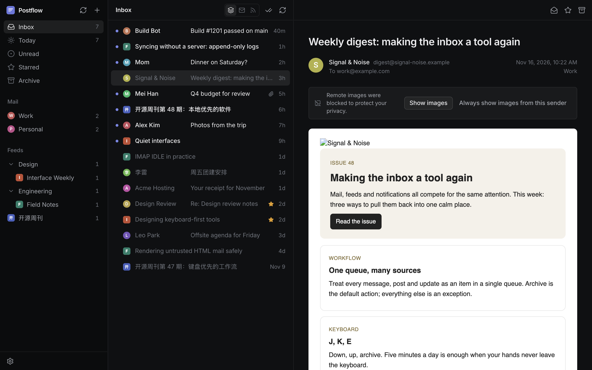
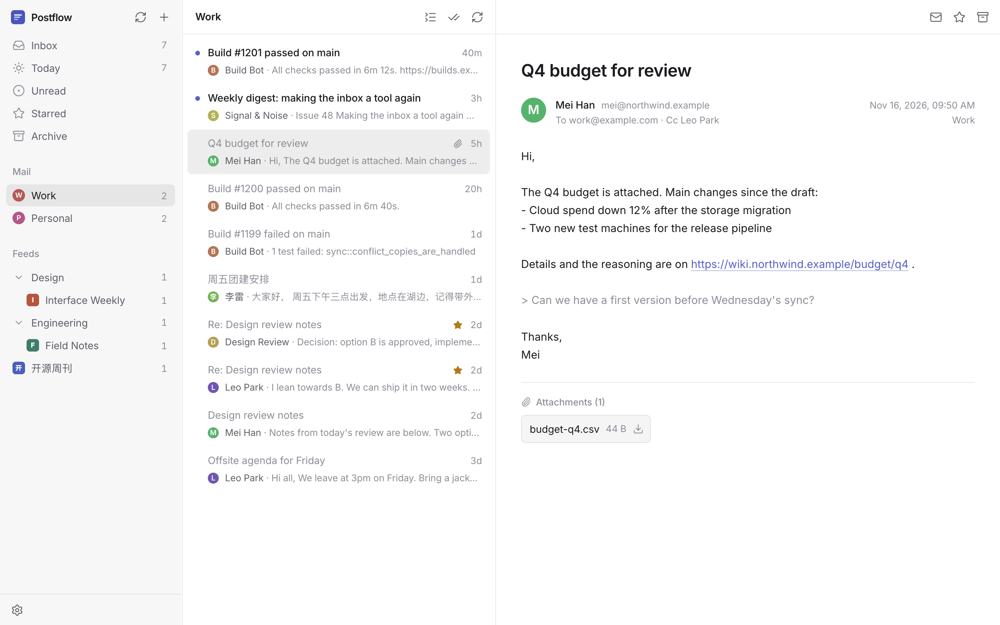
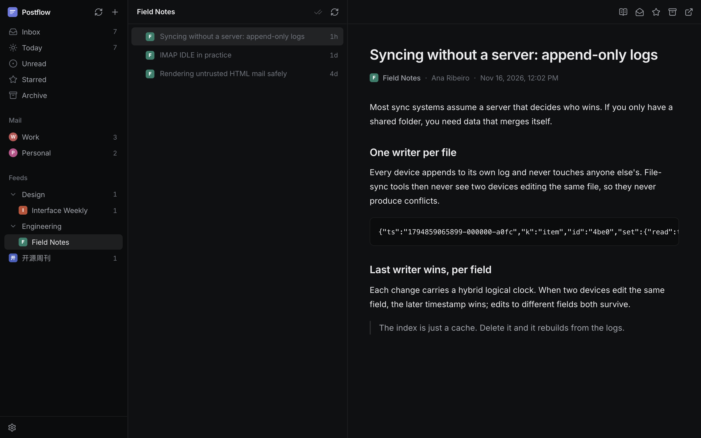
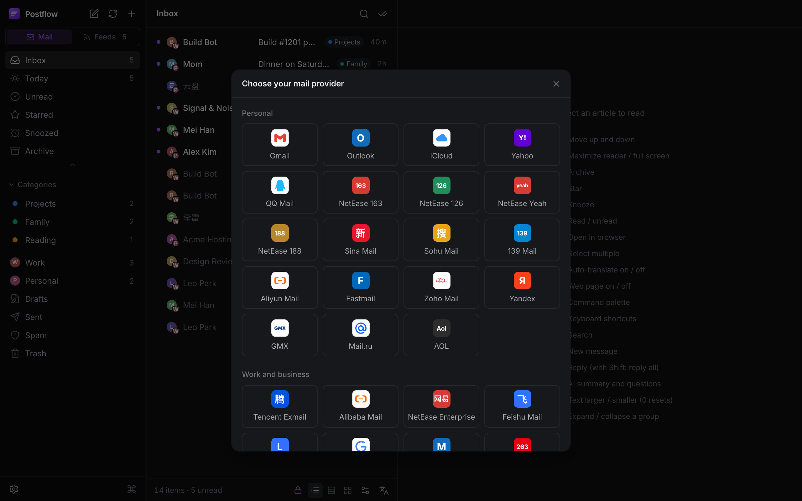
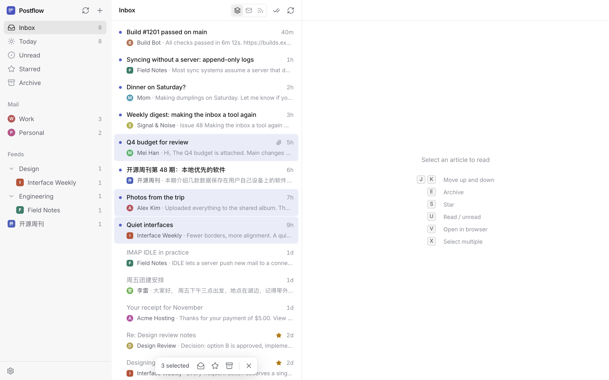

# Postflow

**English** | [简体中文](README.zh-CN.md)

An open-source, cross-platform client that brings your email and RSS feeds into one inbox.

- **Local first.** Postflow talks to your mail servers and feeds directly from your device. No server, no account.
- **Sync on your terms.** Your data is a folder of append-only logs. Keep it in sync between devices with Syncthing, iCloud Drive, Dropbox or any file-sync tool.
- **Keyboard first.** A calm three-pane layout where every frequent action has a single key.



## Screenshots

| | |
|---|---|
|  |  |
| Mail with attachments, in the light theme | Articles from your feeds |
|  |  |
| Pick your provider, or add any IMAP account | Select several items and act on them at once |

## Download

Get the installer for your system from [Releases](https://github.com/Wonvy/Postflow/releases):

| System | File |
|---|---|
| macOS (Apple silicon and Intel) | `.dmg` |
| Windows 10 / 11 | `-setup.exe` or `.msi` |
| Linux | `.deb`, `.rpm` or `.AppImage` |

The installers are not yet signed by Apple or Microsoft. On macOS, the first time you open the app go to
**System Settings → Privacy & Security** and click **Open Anyway**. On Windows, when SmartScreen appears,
click **More info → Run anyway**.

## Features

**Mail**

- Add as many IMAP accounts as you like. Pick your provider from a grid of icons (Gmail, Outlook, iCloud, Yahoo, QQ,
  NetEase, Fastmail, and more), then enter your address and password; the server settings are filled in for you.
- Business addresses on your own domain are detected from their mail records: Google Workspace, Microsoft 365,
  Tencent Exmail, Alibaba Mail, NetEase Enterprise, Feishu and others.
- New mail arrives instantly on servers that support IMAP IDLE. Postflow also checks every five minutes and when you
  switch back to the app, so servers that never announce new mail are covered too.
- HTML mail is sanitized and shown in a sandbox with scripts removed. Remote images, often used to track when you
  open a message, stay blocked until you allow them for one message or for a sender.
- Read, starred and archived states are written back to the server, so your phone and webmail stay in step.
- New mail shows a system notification while Postflow is in the background, and the Dock or taskbar icon shows how
  many inbox messages are unread (the tab title does in a browser). Both can be turned off in Settings → Appearance.
- Newsletters and mailing lists get an Unsubscribe link in the message header. Lists that support one-click
  unsubscribe are unsubscribed right away; otherwise their unsubscribe page or an unsubscribe email opens.
- Write, reply, reply all and forward, in plain text. Replies quote the original below your text and stay in the same
  conversation in other mail apps. The To, Cc and Bcc fields suggest people who have written to you, and the
  mailbox to send from can be picked when you have several. Mail goes from your device straight to your provider's
  outgoing (SMTP) server, which is chosen for you from the provider; set it yourself in the mailbox's settings if
  needed. A copy goes to the Sent folder on the server, unless the provider files one itself (Gmail, Outlook).
- Outlook.com, Hotmail and Microsoft 365 sign in with your Microsoft account (OAuth 2.0) in your browser, so Postflow
  never sees the password. The sign-in stays in this device's keychain and renews itself. See
  [Outlook.com and Microsoft 365](#outlookcom-and-microsoft-365).

**Feeds**

- Paste a website or feed address and Postflow finds the feed. RSS, Atom and JSON Feed are supported. A preview
  appears as soon as you paste: the site's icon, name and description, how often it posts, and its latest items, so
  you can see what you're subscribing to. Sites that offer several feeds let you pick one.
- YouTube channels and playlists: paste an address like `https://www.youtube.com/@name` to subscribe to the channel's
  new videos, with the channel's avatar as the feed icon.
- The folder field lists your recently used folders first; type to filter or to create a new folder. A folder's menu
  in the sidebar has "Add a feed here".
- Folders, per-feed refresh intervals, OPML import and export. Drag feeds to reorder them: drop one on the middle of a
  folder to move it in, or above or below a folder to keep it outside; feeds outside folders and folders can be mixed
  in any order. Mailboxes can be dragged into order too, and the order syncs to your other devices. Right-click a
  mailbox, feed or folder for its menu.
- A warning sign next to a feed means its last refresh failed; hover over it for the reason. Feeds that move with a
  permanent redirect are updated to their new address automatically. When a feed has moved without one, its Edit
  dialog can look for the feed on the site again, or take a new address: Postflow checks it first and keeps the same
  feed, with its read and starred states and earlier items.
- Load the full article from the original page for feeds that only publish a summary. The full-text button in the
  reader is a switch: while it is on, every article you open loads in full. WeChat articles and pages that describe
  their article in structured data are supported. When a page can't be loaded, the reader says why (the site blocks
  apps, needs a login, or loads its text with scripts) and shows the feed's own content.
- Feed stats (the chart icon on the Feeds heading): how often each feed posts, how many of its posts carry the full
  article, and how much of it you actually read — articles opened, read to the end, and reading time, measured from
  scrolling and time spent in the reader while the window is in front. Feeds that fail to fetch, have gone quiet,
  only publish summaries or that you never read are flagged. Reading records stay on this device and can be cleared.
- Reading settings (the Aa button in the reader): text size, line spacing, a sans or serif font and column width,
  kept on this device. HTML mail keeps its own layout and only scales with the text size.
- Web page view (the globe button in the reader, or `W`): a switch that shows each item's original web page right in
  the reader instead of the parsed content. A device picker above the page previews it as Desktop, iPad, iPhone or
  Android, with that device's screen size and, in the desktop app, its user agent; rotate for landscape. The desktop app
  shows the page in a separate web view, so sites that refuse to be embedded still work. In a browser, Postflow checks
  first and, when a site doesn't allow embedding, says so and offers to open it in your browser. Mail without a web
  link keeps its normal view.

**One inbox**

- Mail and articles are sorted together by time. Switch between everything, mail only and feeds only,
  or look at a single account or feed.
- Group similar items from the list toolbar: by conversation (replies fold into the original), or by sender and
  source (a stream of notifications becomes one row). Archiving, starring or marking a group acts on every item in it.
  Every feed, mailbox, folder and view keeps its own display mode and grouping; changing one leaves the others alone.
- Inbox, Today, Unread, Starred and Archive views. Drag items from the list onto Starred or Archive to star or
  archive them.
- Spam and Trash under your mailboxes show what your mail server filed there, so a message caught by the spam
  filter is easy to find. Move it back to the inbox with the same button (or `E`). Gmail only shares these folders
  with mail apps when "Show in IMAP" is ticked for them in its label settings.
- Three ways to show a list: compact rows, a summary with an excerpt and thumbnail, or a grid of cards with cover
  images. Each list remembers its own choice. Hold Ctrl (⌘ on a Mac) and scroll, or pinch on a trackpad, to resize
  the cards.
- List style (the layout button in the list toolbar): title and summary text size, row spacing, padding, how many
  summary lines to show, and whether to show summaries, source icons and images, kept on this device. "Group by date"
  splits the list into Today, Yesterday, This week, Last week, This month and then months, each with a count.
- Every row shows where it came from: the feed's icon for articles, and for mail the sender, with a small badge for
  the mailbox when you have more than one. The reader's toolbar shows the source's icon and name; click it to see
  everything from that feed or mailbox.
- Right-click a row or the reader for its menu: read / unread, star, archive, category, open or copy the link, copy
  the title or sender, and go to the source. In the reader it also copies selected text and links under the pointer.
  Right-click a selected row to act on the whole selection.
- Mark all as read (the double check in the list toolbar, or `Shift` + `A`) asks before it runs.
- Full-text search (the magnifier in the list toolbar, `/` or `⌘F`): titles, senders, authors and the full text of
  articles and mail, Chinese included. Search the current list or everything, including archived items; results show
  where the words appear and highlight them. Enter opens the first result. The index stays on this device and is
  built in the background.
- Offline translation for mail and articles. The translate button in the reader (or `T`) is a switch: while it is on,
  every message and article you open is translated on your device as it opens, keeping its layout and links; turn it
  off for the original. The language is detected for you, and models for more than 50 languages download once (about
  40–70 MB per direction) from Mozilla's Firefox Translations project. Nothing you read is sent anywhere.
- List translation (the translate button in the list toolbar): titles and summaries in the list show in your
  language. Items already in your language are left alone, in the list and in the reader.
- The sidebar's Mail and Feeds sections fold away, or switch to tabs (All / Mail / Feeds, keys `1` `2` `3`): each tab
  is its own workspace with its own views, last list and display mode.
- Dark and light themes, compact and comfortable list density, English and Chinese.
- The same interface also runs in your browser, served by the app on your own machine.
- Updates itself: when a new version is out, Postflow offers to download it, install it and restart. Update
  packages are signed, and the app refuses any package whose signature doesn't match.

**AI (optional, bring your own key)**

- Works with any OpenAI-compatible service: DeepSeek, Qwen, Gemini, OpenAI, Kimi, Zhipu GLM, SiliconFlow, OpenRouter,
  or Ollama and LM Studio running on your own computer. Requests go straight from your computer to the service; keys
  stay in the system keychain. A per-service proxy is supported, otherwise the system proxy is used.
- Press `A` for an AI panel beside the reader: a summary with key points and keywords, and a chat about the message
  or article (key points, what you need to do, draft a reply).
- Translate with AI instead of the offline model, keeping layout and links.
- One-line AI summaries in the summary and card views, and automatic sorting into categories you define, with a
  Categories section in the sidebar. Your own corrections always win.
- Mail is never sent to a cloud service unless you turn that on; local services may read it. Results, chats and usage
  stay on this device, and nothing is sent until you ask (or turn on an automatic feature).

**Not yet available:** drafts, attachments in mail you write (forwarding doesn't carry the original's attachments
yet), formatted (HTML) mail, OAuth sign-in for Gmail (use an app password), folders other than the inbox, spam and
trash, a command palette, snoozing, rules, a tray icon, mobile apps, and installers signed by
Apple and Microsoft. On Linux, only the AppImage can update itself; `.deb` and `.rpm` installs point you to the
download page instead.

## Keyboard shortcuts

| Key | Action |
|---|---|
| `J` / `K` | Next / previous item |
| `E` | Archive (in Archive, Spam or Trash, move back to the inbox) |
| `S` | Star |
| `U` | Read / unread |
| `V` | Open the original page in your browser |
| `X` | Select the current item for a bulk action |
| `→` / `←` | Expand / collapse a group |
| `Shift` + `A` | Mark everything in the list as read (asks first) |
| `T` | Auto-translate on / off |
| `W` | Web page view on / off |
| `/` or `⌘F` / `Ctrl+F` | Search |
| `+` `-` `0` | Larger / smaller text, reset |
| `A` | AI panel: summary and questions |
| `1` `2` `3` | Switch sidebar tab (in the tabs layout) |
| `C` | Write a new message |
| `⌘R` / `Ctrl+R` | Reply |
| `⇧⌘R` / `Ctrl+Shift+R` | Reply all |
| `⇧⌘F` / `Ctrl+Shift+F` | Forward |
| `⌘↩` / `Ctrl+Enter` | Send (while writing) |
| `R` | Refresh all feeds and mail |
| `Esc` | Clear the selection, or close the reader |

## Outlook.com and Microsoft 365

Microsoft no longer lets mail apps sign in to Outlook.com, Hotmail or Microsoft 365 with a password. Postflow signs in
the way Microsoft asks desktop apps to: it opens Microsoft's sign-in page in your browser, Microsoft sends the browser
back to a temporary address on your own computer (`http://localhost:<port>`), and Postflow exchanges that for tokens
(OAuth 2.0 authorization code with PKCE). The refresh token is kept in the system keychain like a password, never in
the data folder, so each device signs in on its own. No server of ours is involved.

This needs an application ID registered with Microsoft. Postflow doesn't come with one: you register your own, so
the sign-in goes through your app and nobody else's. It's free and takes a few minutes:

1. Sign in to the [Microsoft Entra admin center](https://entra.microsoft.com) (or the Azure portal) and open
   **App registrations → New registration**.
2. Give it a name, and under supported account types choose **Accounts in any organizational directory and personal
   Microsoft accounts**.
3. Add a redirect URI with the platform **Public client/native (mobile & desktop)** and the URI `http://localhost`.
4. Copy the **Application (client) ID** from the overview page. It isn't a secret.
5. Optional, but work accounts often need it: under **API permissions**, add the delegated permissions
   `IMAP.AccessAsUser.All`, `SMTP.Send` and `offline_access`.

Then add an Outlook or Microsoft 365 account in Postflow, paste the ID when it asks, and click **Sign in with
Microsoft**. The ID is saved in your settings and syncs to your other devices; **Change application ID** under the
sign-in button replaces it (mailboxes already signed in keep working). Developers can also set the
`POSTFLOW_MICROSOFT_CLIENT_ID` environment variable. Work and school mailboxes need IMAP turned on, and your admin may
have to approve the app. To send mail, Microsoft 365 also needs SMTP sending (authenticated SMTP) allowed for the
mailbox. Mailboxes signed in before Postflow could send keep receiving mail; sign in again from the mailbox's
settings to allow sending.

## Your data

On first launch you choose a data folder. It is the only thing you need to sync or back up:

```
<data folder>/
├─ meta.json                          format version
├─ oplog/<device id>/2026-11.jsonl    changes: feeds, accounts, read, starred, archived, settings
└─ articles/<device id>/2026-11.jsonl archived feed articles
```

- **Each device only appends to its own files** and never edits anyone else's, so file-sync tools never see
  conflicting edits.
- **Every change records only the fields it touched, plus a timestamp.** When two devices edit the same field, the
  later one wins. Replaying a change is harmless, so conflict copies left behind by sync tools are read safely.
- **IDs are derived from content.** Two devices that fetch the same article give it the same ID.
- **Passwords never go into the data folder.** Account settings (address, server) sync to your other devices, but
  each device keeps the password in its own system keychain and asks for it once.
- **Mail stays out of the data folder.** Each device syncs mail from the server itself. Read, starred and archived
  states live on the server, so they are already consistent everywhere.

A line in the change log looks like this:

```json
{"ts":"1794859065899-000000-a0fc06b58629","k":"item","ids":["4be0…","91c2…"],"set":{"read":true}}
```

The SQLite index, fetch state, full-text cache and translation models live in the app's local data folder and are
never synced. The
index is built entirely from the logs: delete it and it is rebuilt, or rebuild it from Settings.

If the data folder lives in a cloud drive, set it to always keep files on this device. Placeholder files whose
contents are still in the cloud cannot be read.

## Development

You need Rust 1.90 or later and Node.js 22 or later. On Linux, also install the WebKitGTK packages Tauri needs; see
[Tauri's prerequisites](https://v2.tauri.app/start/prerequisites/).

```bash
npm install
```

Run the desktop app:

```bash
npm run app
```

Work on the interface in a normal browser (two terminals):

```bash
npm run server
```

```bash
npm run dev
```

Then open <http://localhost:1420>. In this mode the data lives in `.postflow-dev/` inside the repository, away from
your real data.

### Demo data

You don't need a real mailbox to try things out. This starts two fake IMAP servers and three feeds on your machine,
all with fictional content, and delivers a new message every minute:

```bash
npm run demo
```

Add a mail account with the address `work@example.com` or `me@example.org` and the password `demo`. In the server
settings, use `127.0.0.1`, port `1143` or `1144`, and encryption **None**. The command prints the feed addresses.
Sending works too: the demo's outgoing server on port `1025` is picked automatically. Mail to another demo address
lands in its inbox, and a copy shows up in the sender's Sent folder on the fake server.
To keep the demo password out of your keychain, use `npm run server:demo` instead of `npm run server`; it keeps
passwords in memory only.

The demo also has a mailbox that, like Outlook.com, only accepts OAuth sign-in, with a fake Microsoft sign-in page.
Start the app or server with `POSTFLOW_MICROSOFT_AUTHORITY=http://127.0.0.1:1145/common` and
`POSTFLOW_MICROSOFT_CLIENT_ID=demo`, add an **Outlook** account `outlook-demo@example.com`, set the server to
`127.0.0.1`, port `1147`, encryption **None**, then click **Sign in with Microsoft** and **Allow**.

### Tests and checks

```bash
cargo test --workspace
```

```bash
cargo clippy --workspace --all-targets
```

```bash
npm run typecheck
```

### Screenshots

The images in this README are generated from the demo data. After changing the interface, regenerate them with:

```bash
npm run screenshots
```

It needs Google Chrome or Microsoft Edge installed and writes to `docs/screenshots/`.

## Releasing

First write what changed under **Unreleased** in [CHANGELOG.md](CHANGELOG.md), with an `### English` and a
`### 中文` list. The release script turns that heading into the version and date and refuses to run while it's empty.
The notes go at the top of the GitHub release and into `latest.json`, so the app's update window shows them (every
version since the one you have), and Settings → About shows the notes for the installed version.

```bash
npm run release -- 0.2.0
```

```bash
git push --follow-tags
```

The first command sets version 0.2.0 in `package.json`, `Cargo.toml` and both lock files, commits, and tags
`v0.2.0`. Pushing the tag starts GitHub Actions, which builds the installers on macOS, Windows and Linux and
publishes the release once all three succeed. A version with a hyphen, such as `0.2.0-beta.1`, is published as a
pre-release.

Every release also contains signed update packages and a `latest.json`, which installed copies of Postflow check
to update themselves. Signing needs the private key in the repository secret `TAURI_SIGNING_PRIVATE_KEY`
(Settings → Secrets and variables → Actions); the matching public key is in `src-tauri/tauri.conf.json`. Keep a
backup of the private key: without it, installed copies can't verify future updates.

To build installers on your own machine, either set `TAURI_SIGNING_PRIVATE_KEY` to the key, or turn the update
packages off for that build:

```bash
npm run tauri -- build --config '{"bundle":{"createUpdaterArtifacts":false}}'
```

If one platform fails, the release stays as a draft and is not public. After fixing the problem, run the Release
workflow by hand from the Actions page with the same tag.

To ship signed installers later, add your Apple and Microsoft certificates to the repository secrets and pass them to
the build step, following [Tauri's signing guide](https://v2.tauri.app/distribute/sign/macos/).

## Project layout

```
crates/store/     data layer: logs in the data folder, merging across devices, local SQLite index
crates/feed/      feeds: fetching, parsing, discovery, OPML, sanitizing, full-text extraction
crates/mail/      mail: provider detection, IMAP, parsing and safe rendering
crates/ai/        AI services: OpenAI-compatible client, provider presets, prompts and answer parsing
crates/translate/ offline translation: model download and checks, language detection, keeping links and formatting
crates/core/      sessions, scheduling, folder watching; one rpc entry point and one event stream
crates/web/       serves the core over HTTP for the browser interface
crates/testkit/   fake IMAP server for tests, and the demo data server
src-tauri/        desktop and mobile shell; it only forwards calls
src/              React interface, shared by the desktop app and the browser
```

The interface doesn't care where it runs: `src/lib/transport.ts` uses in-process calls in the desktop app and HTTP
in the browser, and both reach the same methods in `crates/core/src/rpc.rs`.

## License

Icons are from [Lucide](https://lucide.dev) (ISC). The font is [Inter](https://rsms.me/inter/) (OFL).
Translation uses the [Firefox Translations](https://github.com/mozilla/translations) models (MPL-2.0), run by
[fxtranslate](https://crates.io/crates/fxtranslate) (MPL-2.0). Models are downloaded on demand and are not bundled.

The project's own license has not been chosen yet.
