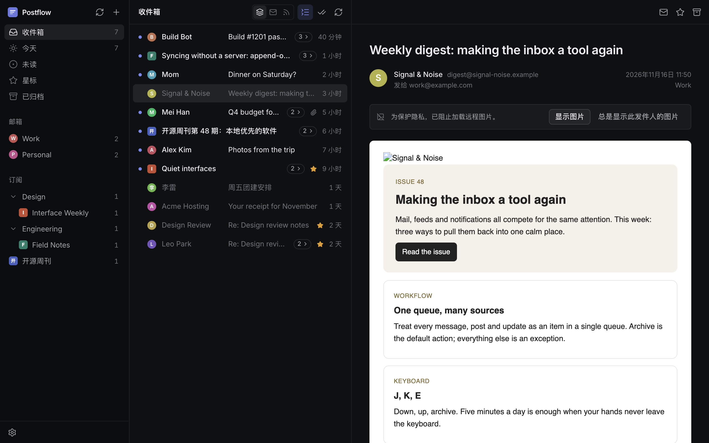
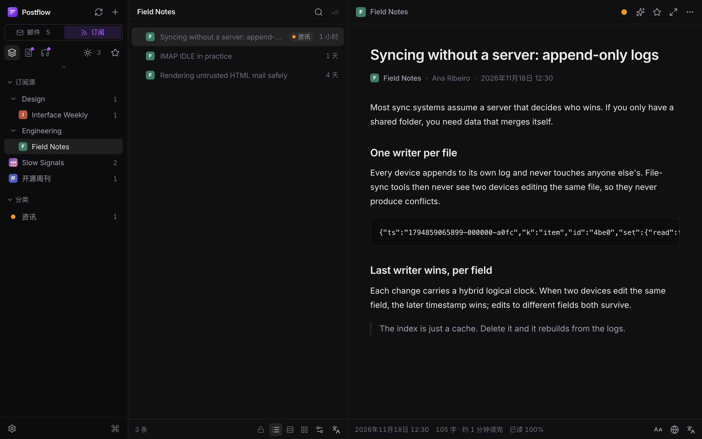

# Postflow

[English](README.md) | **简体中文**

开源、跨平台的个人信息聚合客户端，邮件和 RSS 订阅在同一个应用里，各有各的空间。

- **完全本地**：直接从你的设备连邮箱、抓订阅，不需要服务器，也没有账号。
- **同步交给你自己**：数据是一个装着只追加日志的文件夹，用 Syncthing、iCloud、坚果云之类的工具同步即可。
- **键盘优先**：安静的三栏界面，常用操作都有单键快捷键。



## 截图

| | |
|---|---|
|  |  |
| 带附件的邮件，浅色主题 | 订阅源里的文章 |
|  |  |
| 选择服务商，或添加任意 IMAP 邮箱 | 多选后一次处理 |

## 下载

到 [Releases](https://github.com/Wonvy/Postflow/releases) 下载对应系统的安装包：

| 系统 | 文件 |
|---|---|
| macOS（Apple 芯片和 Intel 通用） | `.dmg` |
| Windows 10 / 11 | `-setup.exe` 或 `.msi` |
| Linux | `.deb`、`.rpm` 或 `.AppImage` |

安装包还没有经过苹果和微软的开发者签名。macOS 第一次打开时，到「系统设置 → 隐私与安全性」里点「仍要打开」；
Windows 出现 SmartScreen 提示时，点「更多信息 → 仍要运行」。

## 功能

**邮件**

- 可以添加任意多个 IMAP 邮箱。从服务商图标里选一个（Gmail、Outlook、iCloud、Yahoo、QQ、网易、Fastmail 等），
  再填地址和密码，服务器设置自动带入。
- 自有域名的企业邮箱通过域名的邮件记录自动识别：Google Workspace、Microsoft 365、腾讯企业邮箱、阿里企业邮箱、
  网易企业邮箱、飞书等。
- 服务器支持 IMAP IDLE 时，新邮件实时到达。另外每五分钟、以及切回应用时都会收一次，从不推送新邮件的服务器也收得到。
- HTML 邮件经过净化，脚本一律去掉，放在沙箱里显示。远程图片常被用来追踪你什么时候打开了邮件，默认不加载，
  可以单封放行，也可以对某个发件人一直放行。
- 已读、星标、归档写回邮件服务器，手机和网页邮箱里的状态保持一致。
- 应用在后台时，新邮件会弹出系统通知；程序坞或任务栏图标上显示收件箱的未读邮件数（浏览器里显示在标签页标题上）。
  两项都可以在设置 → 外观里关掉。
- 邮件列表、电子报的信头上有「退订」：支持一键退订的直接退订，其他的打开退订页面或者写一封退订邮件。
- 写信、回复、全部回复和转发，可以带格式（粗体、斜体、下划线、删除线、链接、列表、引用），也可以写纯文本；
  点「T」切换，会记住你的选择。带格式的信同时附一份纯文本，发出前会清理 HTML。
  回复时原信引在下面，在别的邮件程序里也归在同一个对话里。收件人、抄送、
  密送会从给你来过信的人里提示；有几个邮箱时可以选从哪个发。信从你的设备直接交给邮箱服务商的发信（SMTP）服务器，
  按服务商自动选好，需要时可以在邮箱设置里自己填。发出的信在服务器的「已发送」里存一份；Gmail 和 Outlook
  自己会存，就不再重复存。
- 附件：点回形针、把文件拖进写信窗口，或者粘贴图片。转发时带上原信的附件，不要的可以删掉。
- 草稿：停笔几秒就自动存进邮箱的「草稿」文件夹，手机和网页邮箱里也看得到；关掉窗口草稿还在。
  邮箱列表下面有「草稿」，打开一封就能接着写。发出去或者删掉时，服务器上的草稿也一起删掉。
- 「已发送」里是所有邮箱发出的信，包括在手机和网页邮箱里发的；填收件人时，你写过信的人排在前面。
- 自己建的文件夹：点邮箱右边的小箭头（或者邮箱菜单里的「显示文件夹」），按服务器上的层级列出它的其他文件夹。
  打开一个文件夹才开始同步它，之后 Postflow 开着时一直跟着同步。Gmail 的标签也会显示成文件夹。
- 每个文件夹先收最近的邮件。邮箱或文件夹的列表拉到底，点「从邮箱服务器加载更早的邮件」再取 100 封。
- 把邮件移进文件夹：右键菜单里的「移到文件夹」，或者直接拖到侧栏的文件夹上。
- 每个邮箱可以设一个签名（在邮箱设置里），写信时加在正文后面，回复时在引文上面。
- Outlook.com、Hotmail 和 Microsoft 365 用微软账户登录（OAuth 2.0），登录在浏览器里完成，Postflow 拿不到你的密码。
  登录状态存在这台设备的钥匙串里，会自动续期。详见 [Outlook.com 和 Microsoft 365](#outlookcom-和-microsoft-365)。
  Gmail 也可以这样用 Google 账户登录，或者用应用专用密码，见 [用 Google 账户登录 Gmail](#用-google-账户登录-gmail)。

**订阅**

- 「添加订阅」先打开「发现」页：内置约 150 个知名网站的官方订阅源，带图标，分十类，可以用图标或列表显示。
  界面语言的源排在前面，也可以只看中文或只看英文。可以搜索、一键订阅，或者整个分类一起订阅（每类放进同名文件夹）。
  列表只有一个文件 [`public/catalog/catalog.json`](public/catalog/catalog.json)，图标也在里面；应用每天最多检查一次
  GitHub 上有没有新版本（可以在「设置 → 订阅」里关掉）。检查订阅源、补图标用 [`scripts/catalog.mjs`](scripts/catalog.mjs)。
- 粘贴网站或订阅地址，自动找到订阅源。支持 RSS、Atom 和 JSON Feed。一粘贴就显示预览：网站图标、名称和介绍、
  更新频率，以及最近的几篇，订阅前就知道是什么内容。网站提供好几个源时可以挑一个。
- YouTube 频道和播放列表：贴进 `https://www.youtube.com/@名字` 这样的地址就能订阅博主的新视频，图标用频道头像。
- 选文件夹时，最近用过的排在最前面；输入文字可以筛选，也可以直接建一个新文件夹。侧栏里文件夹的菜单里有
  「在这里添加订阅」。
- 文件夹分组，每个源单独设置刷新间隔，OPML 导入导出。订阅源可以拖动排序：拖到文件夹中间放进去，
  拖到文件夹上沿或下沿就留在文件夹外，文件夹外的源和文件夹可以随意交错排列。邮箱也能拖动排序，
  顺序会同步到其他设备。在邮箱、订阅源或文件夹上点右键打开它的菜单。
- 订阅源旁边的黄色三角表示上次刷新失败，鼠标悬停能看到原因。源用永久跳转搬了家的，会自动换成新地址；
  没有跳转的，可以在它的「编辑」里到网站上重新找订阅源，或者直接填新地址：Postflow 先检查新地址能用才换，
  还是同一个订阅源，已读、星标和以前的文章都保留。
- 只给摘要的源，可以从原网页抓取全文。阅读区的全文按钮是个开关，打开后点开的每篇文章都直接显示全文。
  支持微信公众号文章，以及在结构化数据里写了正文的网页。抓不到时会说明原因（网站不让应用抓、要登录、
  正文靠脚本加载），并显示订阅源里的内容。
- 订阅统计（「订阅」标题旁的图表按钮）：每个订阅源多久更新一次、多少文章带全文，以及你实际读了多少：
  打开了几篇、读完了几篇、读了多久。阅读时长按阅读区里的滚动和停留时间算，窗口在前台时才计时。
  抓取出错、很久没更新、只给摘要、一直没读的源会标出来。阅读记录只存在这台设备上，可以清除。
- 阅读设置（阅读区的 Aa 按钮）：字号、行距、无衬线或衬线字体、版心宽度，只存在这台设备上。
  HTML 邮件保留自己的排版，只跟着字号缩放。
- 原网页模式（阅读区的地球按钮，或 `W`）：一个开关，打开后在列表里点的每一条都在右边直接显示原网页，而不是解析后的正文。
  网页上方可以选模拟的设备：桌面、iPad、iPhone、Android，按设备的屏幕大小显示，桌面应用里还会换成对应的
  User-Agent；可以横竖切换。桌面应用用独立的网页视图显示，禁止被嵌入的网站也能看。浏览器里会先检查，
  网站不允许嵌入时直接说明，并提供在浏览器中打开。没有网页链接的邮件照常显示正文。

**邮件和订阅**

- 邮件和订阅是两个独立的空间，在侧栏顶部切换。两边各有自己的视图、按钮和右键菜单，只显示自己那一类，
  切回来时停在上次看的列表。某个邮箱、邮箱文件夹、订阅源或订阅文件夹在它所属的那一边里看。
- 订阅可以不看：在「设置 → 外观」关掉「显示订阅」（或者右键切换条），侧栏就只有邮件；订阅照常在后台更新。
- 列表工具栏里可以折叠相同邮件：按会话（回复和原邮件合成一行），或按发件人和来源（一连串通知合成一行）。
  对折叠的一组归档、加星标、标已读，会作用到组里的每一条。
  每个订阅源、邮箱、文件夹和视图各自记住显示方式和折叠方式，改一个不影响别的。
- 邮件这边有收件箱、今天、未读、星标、已归档五个视图，订阅这边是全部文章、今天、未读、星标、已归档。把列表里的条目拖到「星标」或「已归档」上，就是加星标或归档。
- 邮箱列表下面的「垃圾邮件」和「已删除」显示邮件服务器放进这两个文件夹的邮件，被误判成垃圾邮件的也能找到，
  用同一个按钮（或 `E`）移回收件箱。Gmail 要在网页版的标签设置里给它们勾上「在 IMAP 中显示」，邮件应用才看得到。
- 列表有三种显示方式：一行一条的列表、带摘要和缩略图的摘要视图、带封面图的卡片。每个列表各自记住。
  按住 Ctrl（Mac 上是 ⌘）滚动滚轮，或者在触控板上双指捏合，可以调整卡片大小。
- 列表样式（列表工具栏里的显示方式按钮）：标题和摘要字号、行间距、内边距、摘要显示几行，以及是否显示摘要、
  来源图标和图片，只存在这台设备上。打开「按日期分组」后，列表分成今天、昨天、本周、上周、本月，再往前按月，
  每段标出条数。
- 每一行都标出来源：文章是订阅源的图标；邮件是发件人，有多个邮箱时头像右下角带一个小的邮箱图标。
  阅读区工具栏左边显示来源的图标和名字，点一下列表就换成那个订阅源或邮箱的全部内容。
- 列表的行和阅读区都有右键菜单：已读 / 未读、星标、归档、分类、打开或复制链接、复制标题或发件人地址、前往来源。
  阅读区里还能复制选中的文字、鼠标下的链接。在勾选着的行上点右键，作用于所有勾选的条目。
- 全部标为已读（列表工具栏的双勾，或 `Shift` + `A`）会先确认一次。
- 全文搜索（列表工具栏的放大镜、`/` 或 `⌘F`）：搜标题、发件人、作者，以及文章和邮件的正文，中文按词也能搜到。
  可以只搜当前列表，也可以搜全部（包括已归档的）；结果里标出命中的词，并显示正文里命中的那一段，回车打开第一条。
  搜索索引只在这台设备上，在后台建立。
- 邮件和文章都能离线翻译。阅读区的翻译按钮（或 `T`）是个开关，打开后点开的每封邮件、每篇文章都在本机自动翻译，
  版式和链接保持不变；关掉就是原文。原文语言自动识别，支持 50 多种语言，模型来自 Mozilla 的 Firefox 翻译项目，
  每个方向约 40–70 MB，只需下载一次。你读的内容不会发到任何地方。
- 列表翻译（列表工具栏上的翻译按钮）：列表里的标题和摘要显示成你的语言；本来就是你的语言的不动，阅读区也一样。
- 侧栏里的分类、邮箱和订阅几组都可以折叠。
- 深色与浅色主题，紧凑与宽松两种列表密度，中英文界面。
- 也能在浏览器里用：在桌面应用的「设置 → 网页访问」里打开，应用会在你选的端口上提供同一套界面和数据。
  见 [在浏览器中使用](#在浏览器中使用)。
- 在线更新：有新版本时，Postflow 会提示下载、安装并重启。更新包经过签名，签名对不上的包不会被安装。

**高效处理**

- 稍后提醒（阅读区的闹钟按钮，或右键）：稍后、今晚、明早、这个周末、下周，或者自己挑时间。到时间前从收件箱里拿走，
  放在「稍后提醒」里；到时间回到收件箱顶部，标为未读并弹提醒。提醒时间会同步到其他设备，邮件也一样。
- 撤销发送：点「发送」后有几秒钟可以撤回（设置 → 外观，默认 5 秒，也可以关掉）。
- 定时发送（「发送」旁边的时钟）：挑一个时间，到时 Postflow 自动发出。等着发的在邮件侧栏的「定时发送」里，
  可以立即发送或取消（存回草稿）。到时间时 Postflow 要开着才能发；关着的话下次打开时补发。
- 命令面板（`⌘K` / `Ctrl+K`，或侧栏底部的按钮）：前往任意视图、邮箱、订阅源、文件夹、分类、设置页，或者处理打开的这一条。
- 关闭窗口后留在托盘（菜单栏）里继续收信，图标上显示未读数。可以在「设置 → 外观」里关掉。
- 手机上也能用：屏幕窄时一次只显示一栏，侧栏从左边滑出来，阅读区左上角返回。通过[网页访问](#在浏览器中使用)在手机上打开。

**AI（可选，用你自己的 API Key）**

- 支持任何 OpenAI 兼容接口：DeepSeek、通义千问、Gemini、OpenAI、Kimi、智谱 GLM、硅基流动、OpenRouter，
  以及在本机运行的 Ollama、LM Studio。从你的电脑直接请求，没有中间服务器；密钥存在系统钥匙串里。
  每个服务可以单独设代理，不设就跟随系统代理。
- 按 `A` 打开阅读面板旁的 AI 栏：一句话总结、要点和关键词，还可以围绕这封邮件或这篇文章提问
  （有哪些要点、有没有需要我做的事、帮我起草回复）。
- 翻译可以改用 AI，版式和链接保持不变。
- 摘要和卡片视图里可以显示一句话的 AI 摘要。你定义的类别在侧栏两边的「分类」里都有，数字只算这一边的；新内容按你的规则自动分类（设置 → 自动规则），
  也可以点「立即分类」让 AI 把最近的内容分一次。你手动改的以你为准。
- 邮件默认不发给云端 AI，需要在设置里打开；本机运行的服务不受限制。生成的内容、对话和用量只存在这台设备上；
  你不点、也没打开自动功能时，什么都不会发出去。

**还没有的**：命令面板、稍后提醒、规则、托盘常驻、移动端、苹果和微软的安装包签名。Linux 上只有 AppImage 能在应用里直接更新，
用 `.deb`、`.rpm` 安装的会引导你去下载页。

## 快捷键

| 按键 | 作用 |
|---|---|
| `J` / `K` | 下一条 / 上一条 |
| `E` | 归档，在已归档、垃圾邮件、已删除里是移回收件箱 |
| `S` | 星标 |
| `U` | 已读 / 未读 |
| `V` | 在浏览器中打开原文 |
| `X` | 勾选当前条目，用于批量操作 |
| `→` / `←` | 展开 / 收起折叠的一组 |
| `Shift` + `A` | 当前列表全部标为已读（会先确认） |
| `T` | 自动翻译 开 / 关 |
| `W` | 原网页 开 / 关 |
| `F` | 最大化阅读区（隐藏侧栏和列表），`Esc` 还原 |
| `Shift+F` | 全屏，阅读区同时最大化，`Esc` 退出 |
| `⌘K` / `Ctrl+K` | 命令面板：前往任意邮箱、订阅源、文件夹、分类，或者执行命令 |
| `/` 或 `⌘F` / `Ctrl+F` | 搜索 |
| `+` `-` `0` | 字号 放大 / 缩小 / 恢复 |
| `A` | AI 栏：总结与问答 |
| `C` | 写新邮件 |
| `⌘R` / `Ctrl+R` | 回复 |
| `⇧⌘R` / `Ctrl+Shift+R` | 全部回复 |
| `⇧⌘F` / `Ctrl+Shift+F` | 转发 |
| `⌘↩` / `Ctrl+Enter` | 发送（写信时） |
| `R` | 刷新当前这一边：收全部邮件，或刷新全部订阅 |
| `Esc` | 取消勾选，或关闭阅读面板 |

## Outlook.com 和 Microsoft 365

微软已经不允许邮件应用用密码登录 Outlook.com、Hotmail 和 Microsoft 365。Postflow 按微软对桌面应用的要求登录：
在浏览器里打开微软的登录页，微软登录完把浏览器带回你自己电脑上的一个临时地址（`http://localhost:端口`），
Postflow 用它换来令牌（OAuth 2.0 授权码 + PKCE）。刷新令牌和密码一样存在系统钥匙串里，不进数据目录，
所以每台设备各自登录一次。整个过程没有我们的服务器参与。

这需要一个在微软注册的应用 ID。Postflow 不自带，由你自己注册，登录走的是你自己的应用。免费，几分钟就好：

1. 用任意微软账户登录 [Microsoft Entra 管理中心](https://entra.microsoft.com)（或 Azure 门户），打开
   「应用注册 → 新注册」。
2. 名称随意；「受支持的账户类型」选「任何组织目录中的账户和个人 Microsoft 账户」。
3. 添加重定向 URI：平台选「公共客户端/本机（移动和桌面）」，地址填 `http://localhost`。
4. 在概述页复制「应用程序(客户端) ID」。它不是密钥，可以放心填。
5. 可选，工作账户常常需要：在「API 权限」里添加委托权限 `IMAP.AccessAsUser.All`、`SMTP.Send` 和 `offline_access`。

然后在 Postflow 里添加 Outlook 或 Microsoft 365 邮箱，按提示粘贴这个 ID，点「用微软账户登录」。ID 存在设置里，
会同步到你的其他设备；登录按钮下面的「更换应用 ID」可以换一个（已经登录的邮箱不受影响）。开发时也可以用环境变量
`POSTFLOW_MICROSOFT_CLIENT_ID`。工作和学校邮箱要开启 IMAP，
管理员可能需要先批准这个应用。要发信的话，Microsoft 365 还要允许这个邮箱用 SMTP 发信（经过身份验证的 SMTP）。
在 Postflow 能发信之前登录的邮箱照常收信；要发信时在邮箱设置里重新登录一次即可。

## 用 Google 账户登录 Gmail

Gmail 和 Google Workspace 用应用专用密码就能登录，这是最快的办法。Postflow 也可以用 Google 账户登录
（OAuth 2.0 + PKCE，在浏览器里完成，和微软的一样）。和微软一样，Google 也需要一个你自己注册的 OAuth 客户端，
注册一次就好：

1. 在 [Google Cloud 控制台](https://console.cloud.google.com) 新建一个项目，打开「API 和服务 → OAuth 同意屏幕」
   并设置好（选「外部」；Workspace 域名可以选「内部」），把自己的邮箱加为测试用户。
2. 在「凭据」里新建「OAuth 客户端 ID」，类型选「桌面应用」，复制客户端 ID 和客户端密钥。
   Google 要求桌面应用也带上密钥，但它在桌面应用里并不保密。
3. 在 Postflow 里添加 Gmail 邮箱，选「Google 账户登录」，粘贴 ID 和密钥，点「用 Google 账户登录」。
   它们存在设置里，会同步到你的其他设备。

同意屏幕处于「测试」状态时，Google 会在七天后让登录失效；改成「正式版」就不会。之后 Google 会提示应用未经验证
（因为要的是完整的邮件权限），只有你自己用的话，在「高级」里选择继续即可。开发时也可以改用环境变量
`POSTFLOW_GOOGLE_CLIENT_ID` 和 `POSTFLOW_GOOGLE_CLIENT_SECRET`。

## 在浏览器中使用

桌面应用可以把 Postflow 提供给浏览器，这台电脑上的、或者手机上的都行：

1. 打开「设置 → 网页访问」，打开「在浏览器中使用 Postflow」。
2. 点链接旁边的打开按钮，浏览器里就是和应用里一样的邮箱和订阅。
3. 要在手机或同一网络里的其他电脑上用，打开「允许局域网访问」，扫二维码（或者把链接发给自己）。

链接里带着访问密钥，第一次打开后浏览器会记住，以后只要地址就行。「更换访问密钥」会让所有旧链接和已经打开的
网页失效。其他网站发来的请求一律拒绝。网页版是桌面应用提供的，关掉应用就停了。连接没有加密（普通 HTTP），
只在信得过的网络里打开局域网访问。

## 数据

首次启动时选择一个数据目录。它是唯一需要同步和备份的东西：

```
<数据目录>/
├─ meta.json                          格式版本
├─ oplog/<设备ID>/2026-11.jsonl       状态变更：订阅、邮箱账户、已读、星标、归档、设置
└─ articles/<设备ID>/2026-11.jsonl    文章存档
```

- **每台设备只往自己的文件里追加**，从不修改别的设备的文件，所以同步工具不会遇到两边改同一个文件的冲突。
- **每条操作只记录改动的字段和一个时间戳**。两台设备改了同一个字段时，时间晚的那次生效。
  重复读入同一条操作没有副作用，同步工具留下的冲突副本可以放心地一并读入。
- **条目 ID 由内容算出**。两台设备各自抓到同一篇文章时得到相同的 ID。
- **密码永远不写进数据目录**。邮箱账户的设置（地址、服务器）会同步到其他设备，
  密码只存在每台设备自己的系统钥匙串里，新设备上第一次使用时输入一次。
- **邮件不进数据目录**。每台设备各自从邮件服务器同步，已读、星标、归档以服务器为准，本来就跨设备一致。

操作日志的一行长这样：

```json
{"ts":"1794859065899-000000-a0fc06b58629","k":"item","ids":["4be0…","91c2…"],"set":{"read":true}}
```

SQLite 索引、抓取状态、全文缓存和翻译模型只存在本机的应用数据目录里，不参与同步。
索引完全由日志推导而来，删掉后会自动重建，也可以在设置里手动重建。

把数据目录放在云盘里时，请把它设为始终保留在本机。只留占位符、内容还在云端的文件读不到。

## 开发

需要 Rust 1.90 以上和 Node.js 22 以上。Linux 上还需要 Tauri 依赖的 WebKitGTK，见
[Tauri 的环境准备文档](https://v2.tauri.app/start/prerequisites/)。

```bash
npm install
```

运行桌面应用：

```bash
npm run app
```

在普通浏览器里开发界面（两个终端）：

```bash
npm run server
```

```bash
npm run dev
```

然后打开 <http://localhost:1420>。这种方式下数据放在仓库里的 `.postflow-dev/`，不会碰你真实的数据。

### 演示数据

试用不需要真实邮箱。下面这条命令会在本机起两个假的 IMAP 服务器和三个订阅源，内容都是虚构的，
每分钟还会投递一封新邮件：

```bash
npm run demo
```

添加邮箱时，地址填 `work@example.com` 或 `me@example.org`，密码填 `demo`；
服务器设置里填 `127.0.0.1`、端口 `1143` 或 `1144`、加密选「不加密」。订阅源地址会在命令输出里列出。
也可以试着发信：演示的发信服务器在 `1025` 端口，会自动选上。发给另一个演示地址的信会出现在它的收件箱里，
发件人在假服务器上的「已发送」里也有一份。
不想让演示密码进系统钥匙串的话，把 `npm run server` 换成 `npm run server:demo`，密码只存在内存里。

演示里还有一个像 Outlook.com 一样只接受 OAuth 登录的邮箱，配了一个假的微软登录页。启动应用或服务时带上
`POSTFLOW_MICROSOFT_AUTHORITY=http://127.0.0.1:1145/common` 和 `POSTFLOW_MICROSOFT_CLIENT_ID=demo`，
添加 **Outlook** 邮箱 `outlook-demo@example.com`，服务器设置填 `127.0.0.1`、端口 `1147`、加密选「不加密」，
再点「用微软账户登录」、在假登录页上点 **Allow**。

### 测试与检查

```bash
cargo test --workspace
```

```bash
cargo clippy --workspace --all-targets
```

```bash
npm run typecheck
```

### 截图

这份说明里的图片是用演示数据自动生成的。改了界面之后，用下面的命令重新生成：

```bash
npm run screenshots
```

需要本机装有 Google Chrome 或 Microsoft Edge，图片写到 `docs/screenshots/`。

## 发布新版本

先在 [CHANGELOG.md](CHANGELOG.md) 的 **Unreleased** 下面写好这一版改了什么，`### English` 和 `### 中文` 各一段列表。
发版脚本会把这个标题换成版本号和日期，没写时不让发。这些说明放在 GitHub 发布页最前面，也放进 `latest.json`：
应用的更新窗口直接显示它们（从你装的版本之后的每一版），设置的「关于」里显示当前这一版的说明。

```bash
npm run release -- 0.2.0
```

```bash
git push --follow-tags
```

第一条命令把 `package.json`、`Cargo.toml` 和两个锁文件里的版本号改成 0.2.0，提交并打上 `v0.2.0` 标签。
推送标签后，GitHub Actions 会在 macOS、Windows、Linux 上分别打包，三个都成功后自动发布 Release。
带横线的版本号（例如 `0.2.0-beta.1`）会发布成预发布版本。

每个 Release 里还有签过名的更新包和一个 `latest.json`，已安装的 Postflow 靠它们在线更新。
签名用的私钥要放在仓库的 Secret `TAURI_SIGNING_PRIVATE_KEY` 里（Settings → Secrets and variables → Actions），
对应的公钥在 `src-tauri/tauri.conf.json`。请备份好私钥：丢了的话，已安装的版本就无法验证以后的更新。

在自己电脑上打安装包时，要么把私钥设到环境变量 `TAURI_SIGNING_PRIVATE_KEY`，要么这次不生成更新包：

```bash
npm run tauri -- build --config '{"bundle":{"createUpdaterArtifacts":false}}'
```

某个平台打包失败时，Release 停留在草稿状态，不会对外公开。修好后在 Actions 页面手动运行 Release 流程，
填入同一个标签即可重新打包。

以后有了苹果和微软的签名证书，按 [Tauri 的签名文档](https://v2.tauri.app/distribute/sign/macos/)
把证书放进仓库的 Secrets，再在发布流程里传给打包步骤就行。

## 代码结构

```
crates/store/     数据层：数据目录里的日志、多设备合并、本机 SQLite 索引
crates/feed/      订阅源：抓取、解析、发现、OPML、正文净化、全文提取
crates/mail/      邮件：服务商识别、IMAP、邮件解析与安全渲染
crates/ai/        AI 服务：OpenAI 兼容客户端、服务商预设、提示词与回答解析
crates/translate/ 离线翻译：模型下载与校验、语言识别、保留链接和格式
crates/core/      会话、调度、目录监听，对外只有一个 rpc 入口和一个事件流
crates/web/       通过 HTTP 暴露核心，供浏览器里的界面使用
crates/testkit/   测试用的假 IMAP 服务器，以及演示数据服务
src-tauri/        桌面与移动端外壳，只做转发
src/              React 界面，桌面应用和浏览器共用
```

界面不直接依赖运行环境：`src/lib/transport.ts` 在桌面应用里走进程内调用，在浏览器里走 HTTP，
两边调用的是 `crates/core/src/rpc.rs` 里的同一组方法。

## 许可

图标来自 [Lucide](https://lucide.dev)（ISC），字体是 [Inter](https://rsms.me/inter/)（OFL）。
翻译使用 [Firefox Translations](https://github.com/mozilla/translations) 的模型（MPL-2.0），
由 [fxtranslate](https://crates.io/crates/fxtranslate)（MPL-2.0）运行。模型按需下载，不随应用打包。

Postflow 是自由软件，采用 [GNU 通用公共许可证 第 3 版或更新版本](LICENSE)（GPL-3.0-or-later）：可以使用、研究、分享和修改，但基于它发布的作品也必须用同样的许可证开源。
