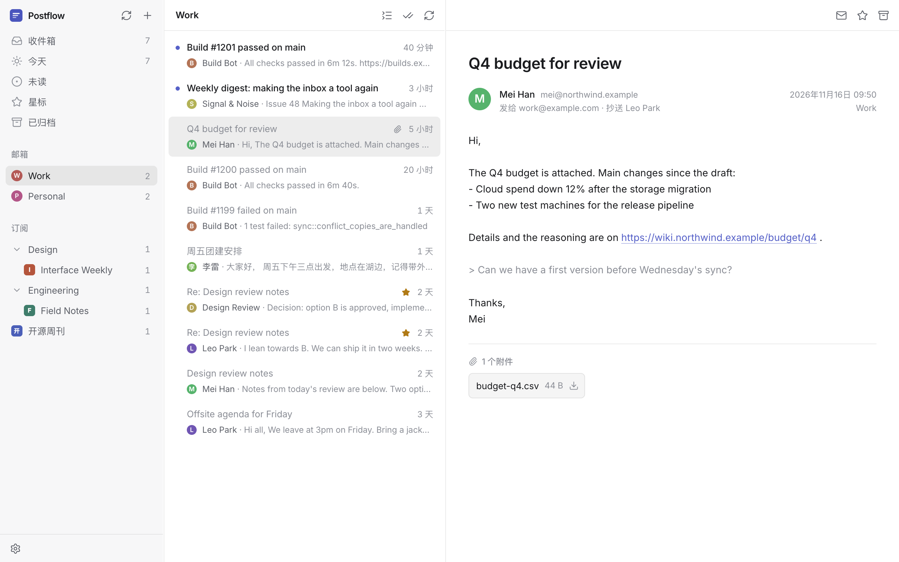
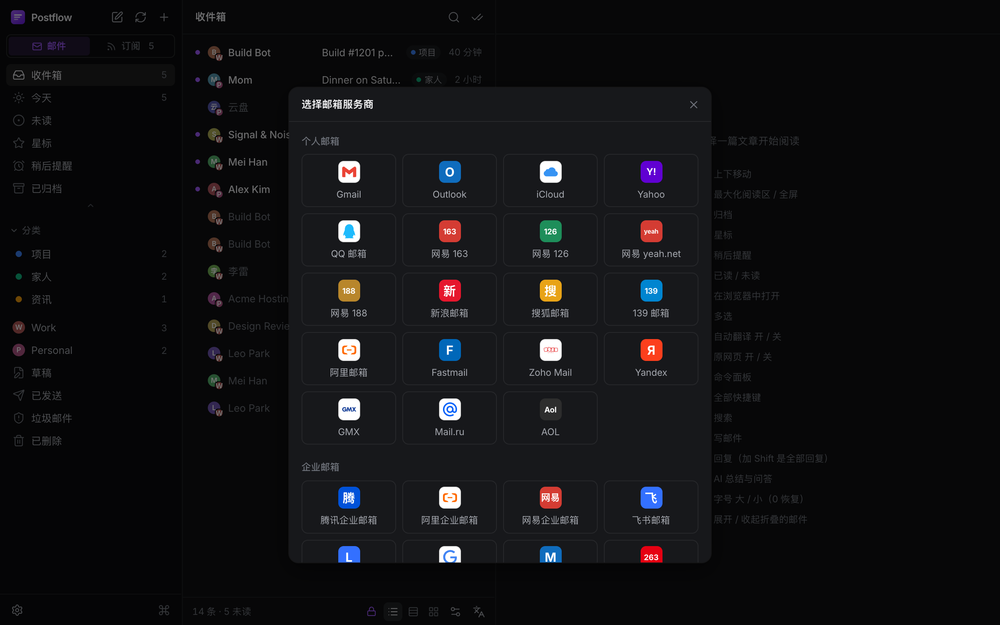
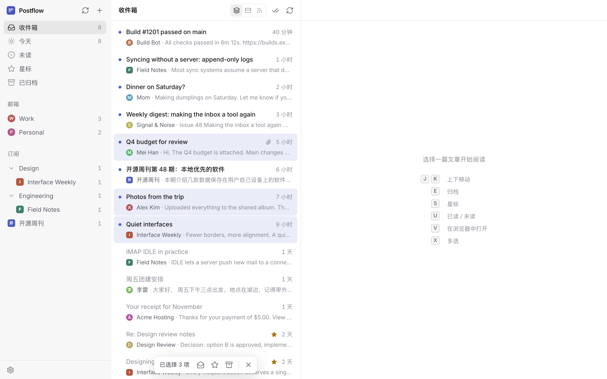

# Postflow

[English](README.md) | **简体中文**

开源、跨平台的个人信息聚合客户端，把邮件和 RSS 订阅放进同一个收件箱。

- **完全本地**：直接从你的设备连邮箱、抓订阅，不需要服务器，也没有账号。
- **同步交给你自己**：数据是一个装着只追加日志的文件夹，用 Syncthing、iCloud、坚果云之类的工具同步即可。
- **键盘优先**：安静的三栏界面，常用操作都有单键快捷键。


## 截图

| | |
|---|---|
|  |  |
| 带附件的邮件，浅色主题 | 订阅源里的文章 |
|  |  |
| 选择服务商，或添加任意 IMAP 邮箱 | 多选后一次处理 |

## 下载

到 [Releases](https://github.com/Wonvy/Postflow/releases) 下载对应系统的安装包：

| 系统 | 文件 |
|---|---|
| macOS（Apple 芯片和 Intel 通用） | `.dmg` |
| Windows 10 / 11 | `-setup.exe` 或 `.msi` |
| Linux | `.deb`、`.rpm` 或 `.AppImage` |

安装包还没有经过苹果和微软的开发者签名。macOS 第一次打开时，到「系统设置 → 隐私与安全性」里点「仍要打开」；
Windows 出现 SmartScreen 提示时，点「更多信息 → 仍要运行」。

## 功能

**邮件**

- 可以添加任意多个 IMAP 邮箱。从服务商图标里选一个（Gmail、Outlook、iCloud、Yahoo、QQ、网易、Fastmail 等），
  再填地址和密码，服务器设置自动带入。
- 自有域名的企业邮箱通过域名的邮件记录自动识别：Google Workspace、Microsoft 365、腾讯企业邮箱、阿里企业邮箱、
  网易企业邮箱、飞书等。
- 服务器支持 IMAP IDLE 时，新邮件实时到达。
- HTML 邮件经过净化，脚本一律去掉，放在沙箱里显示。远程图片常被用来追踪你什么时候打开了邮件，默认不加载，
  可以单封放行，也可以对某个发件人一直放行。
- 已读、星标、归档写回邮件服务器，手机和网页邮箱里的状态保持一致。

**订阅**

- 粘贴网站或订阅地址，自动找到订阅源。支持 RSS、Atom 和 JSON Feed。
- 文件夹分组，每个源单独设置刷新间隔，OPML 导入导出。订阅源可以拖动排序，拖到文件夹上放进去，
  拖到「订阅」标题上移出来。邮箱和文件夹也能拖动排序，顺序会同步到其他设备。
- 只给摘要的源，可以从原网页抓取全文。

**统一收件箱**

- 邮件和文章按时间混排，可以切换「全部 / 只看邮件 / 只看订阅」，也可以只看某个邮箱或订阅源。
- 列表工具栏里可以折叠相同邮件：按会话（回复和原邮件合成一行），或按发件人和来源（一连串通知合成一行）。
  对折叠的一组归档、加星标、标已读，会作用到组里的每一条。
  每个订阅源、邮箱、文件夹和视图各自记住显示方式和折叠方式，改一个不影响别的。
- 收件箱、今天、未读、星标、已归档五个视图。把列表里的条目拖到「星标」或「已归档」上，就是加星标或归档。
- 列表有三种显示方式：一行一条的列表、带摘要和缩略图的摘要视图、带封面图的卡片。每个列表各自记住。
  按住 Ctrl（Mac 上是 ⌘）滚动滚轮，或者在触控板上双指捏合，可以调整卡片大小。
- 邮件和文章都能离线翻译。按 `T` 在本机翻译，版式和链接保持不变，再按一次回到原文。原文语言自动识别，
  支持 50 多种语言，模型来自 Mozilla 的 Firefox 翻译项目，每个方向约 40–70 MB，只需下载一次。你读的内容不会发到任何地方。
- 侧栏里「邮箱」「订阅」两组可以折叠，也可以换成选项卡（全部 / 邮件 / 订阅，按 `1` `2` `3` 切换）：
  每个选项卡是一个独立的工作区，视图、上次停在的列表和显示方式各自记住。
- 深色与浅色主题，紧凑与宽松两种列表密度，中英文界面。
- 同一套界面也能在浏览器里打开，由你自己电脑上的应用提供。
- 在线更新：有新版本时，Postflow 会提示下载、安装并重启。更新包经过签名，签名对不上的包不会被安装。

**AI（可选，用你自己的 API Key）**

- 支持任何 OpenAI 兼容接口：DeepSeek、通义千问、Gemini、OpenAI、Kimi、智谱 GLM、硅基流动、OpenRouter，
  以及在本机运行的 Ollama、LM Studio。从你的电脑直接请求，没有中间服务器；密钥存在系统钥匙串里。
  每个服务可以单独设代理，不设就跟随系统代理。
- 按 `A` 打开阅读面板旁的 AI 栏：一句话总结、要点和关键词，还可以围绕这封邮件或这篇文章提问
  （有哪些要点、有没有需要我做的事、帮我起草回复）。
- 翻译可以改用 AI，版式和链接保持不变。
- 摘要和卡片视图里可以显示一句话的 AI 摘要；按你定义的类别自动分类，侧栏有「分类」分组。你手动改的以你为准。
- 邮件默认不发给云端 AI，需要在设置里打开；本机运行的服务不受限制。生成的内容、对话和用量只存在这台设备上；
  你不点、也没打开自动功能时，什么都不会发出去。

**还没有的**：写信与回复、Outlook 与 Microsoft 365 的 OAuth 登录、收件箱以外的文件夹、搜索、命令面板、
稍后提醒、规则、托盘常驻、移动端、苹果和微软的安装包签名。Linux 上只有 AppImage 能在应用里直接更新，
用 `.deb`、`.rpm` 安装的会引导你去下载页。

## 快捷键

| 按键 | 作用 |
|---|---|
| `J` / `K` | 下一条 / 上一条 |
| `E` | 归档，在已归档视图里是移回收件箱 |
| `S` | 星标 |
| `U` | 已读 / 未读 |
| `V` | 在浏览器中打开原文 |
| `X` | 勾选当前条目，用于批量操作 |
| `→` / `←` | 展开 / 收起折叠的一组 |
| `Shift` + `A` | 当前列表全部标为已读 |
| `T` | 翻译 / 显示原文 |
| `A` | AI 栏：总结与问答 |
| `1` `2` `3` | 切换侧栏选项卡（选项卡布局下） |
| `R` | 刷新全部订阅和邮箱 |
| `Esc` | 取消勾选，或关闭阅读面板 |

## 数据

首次启动时选择一个数据目录。它是唯一需要同步和备份的东西：

```
<数据目录>/
├─ meta.json                          格式版本
├─ oplog/<设备ID>/2026-11.jsonl       状态变更：订阅、邮箱账户、已读、星标、归档、设置
└─ articles/<设备ID>/2026-11.jsonl    文章存档
```

- **每台设备只往自己的文件里追加**，从不修改别的设备的文件，所以同步工具不会遇到两边改同一个文件的冲突。
- **每条操作只记录改动的字段和一个时间戳**。两台设备改了同一个字段时，时间晚的那次生效。
  重复读入同一条操作没有副作用，同步工具留下的冲突副本可以放心地一并读入。
- **条目 ID 由内容算出**。两台设备各自抓到同一篇文章时得到相同的 ID。
- **密码永远不写进数据目录**。邮箱账户的设置（地址、服务器）会同步到其他设备，
  密码只存在每台设备自己的系统钥匙串里，新设备上第一次使用时输入一次。
- **邮件不进数据目录**。每台设备各自从邮件服务器同步，已读、星标、归档以服务器为准，本来就跨设备一致。

操作日志的一行长这样：

```json
{"ts":"1794859065899-000000-a0fc06b58629","k":"item","ids":["4be0…","91c2…"],"set":{"read":true}}
```

SQLite 索引、抓取状态、全文缓存和翻译模型只存在本机的应用数据目录里，不参与同步。
索引完全由日志推导而来，删掉后会自动重建，也可以在设置里手动重建。

把数据目录放在云盘里时，请把它设为始终保留在本机。只留占位符、内容还在云端的文件读不到。

## 开发

需要 Rust 1.90 以上和 Node.js 22 以上。Linux 上还需要 Tauri 依赖的 WebKitGTK，见
[Tauri 的环境准备文档](https://v2.tauri.app/start/prerequisites/)。

```bash
npm install
```

运行桌面应用：

```bash
npm run app
```

在普通浏览器里开发界面（两个终端）：

```bash
npm run server
```

```bash
npm run dev
```

然后打开 <http://localhost:1420>。这种方式下数据放在仓库里的 `.postflow-dev/`，不会碰你真实的数据。

### 演示数据

试用不需要真实邮箱。下面这条命令会在本机起两个假的 IMAP 服务器和三个订阅源，内容都是虚构的，
每分钟还会投递一封新邮件：

```bash
npm run demo
```

添加邮箱时，地址填 `work@example.com` 或 `me@example.org`，密码填 `demo`；
服务器设置里填 `127.0.0.1`、端口 `1143` 或 `1144`、加密选「不加密」。订阅源地址会在命令输出里列出。
不想让演示密码进系统钥匙串的话，把 `npm run server` 换成 `npm run server:demo`，密码只存在内存里。

### 测试与检查

```bash
cargo test --workspace
```

```bash
cargo clippy --workspace --all-targets
```

```bash
npm run typecheck
```

### 截图

这份说明里的图片是用演示数据自动生成的。改了界面之后，用下面的命令重新生成：

```bash
npm run screenshots
```

需要本机装有 Google Chrome 或 Microsoft Edge，图片写到 `docs/screenshots/`。

## 发布新版本

```bash
npm run release -- 0.2.0
```

```bash
git push --follow-tags
```

第一条命令把 `package.json`、`Cargo.toml` 和两个锁文件里的版本号改成 0.2.0，提交并打上 `v0.2.0` 标签。
推送标签后，GitHub Actions 会在 macOS、Windows、Linux 上分别打包，三个都成功后自动发布 Release。
带横线的版本号（例如 `0.2.0-beta.1`）会发布成预发布版本。

每个 Release 里还有签过名的更新包和一个 `latest.json`，已安装的 Postflow 靠它们在线更新。
签名用的私钥要放在仓库的 Secret `TAURI_SIGNING_PRIVATE_KEY` 里（Settings → Secrets and variables → Actions），
对应的公钥在 `src-tauri/tauri.conf.json`。请备份好私钥：丢了的话，已安装的版本就无法验证以后的更新。

在自己电脑上打安装包时，要么把私钥设到环境变量 `TAURI_SIGNING_PRIVATE_KEY`，要么这次不生成更新包：

```bash
npm run tauri -- build --config '{"bundle":{"createUpdaterArtifacts":false}}'
```

某个平台打包失败时，Release 停留在草稿状态，不会对外公开。修好后在 Actions 页面手动运行 Release 流程，
填入同一个标签即可重新打包。

以后有了苹果和微软的签名证书，按 [Tauri 的签名文档](https://v2.tauri.app/distribute/sign/macos/)
把证书放进仓库的 Secrets，再在发布流程里传给打包步骤就行。

## 代码结构

```
crates/store/     数据层：数据目录里的日志、多设备合并、本机 SQLite 索引
crates/feed/      订阅源：抓取、解析、发现、OPML、正文净化、全文提取
crates/mail/      邮件：服务商识别、IMAP、邮件解析与安全渲染
crates/ai/        AI 服务：OpenAI 兼容客户端、服务商预设、提示词与回答解析
crates/translate/ 离线翻译：模型下载与校验、语言识别、保留链接和格式
crates/core/      会话、调度、目录监听，对外只有一个 rpc 入口和一个事件流
crates/web/       通过 HTTP 暴露核心，供浏览器里的界面使用
crates/testkit/   测试用的假 IMAP 服务器，以及演示数据服务
src-tauri/        桌面与移动端外壳，只做转发
src/              React 界面，桌面应用和浏览器共用
```

界面不直接依赖运行环境：`src/lib/transport.ts` 在桌面应用里走进程内调用，在浏览器里走 HTTP，
两边调用的是 `crates/core/src/rpc.rs` 里的同一组方法。

## 许可

图标来自 [Lucide](https://lucide.dev)（ISC），字体是 [Inter](https://rsms.me/inter/)（OFL）。
翻译使用 [Firefox Translations](https://github.com/mozilla/translations) 的模型（MPL-2.0），
由 [fxtranslate](https://crates.io/crates/fxtranslate)（MPL-2.0）运行。模型按需下载，不随应用打包。

项目自身的开源许可证尚未确定。
